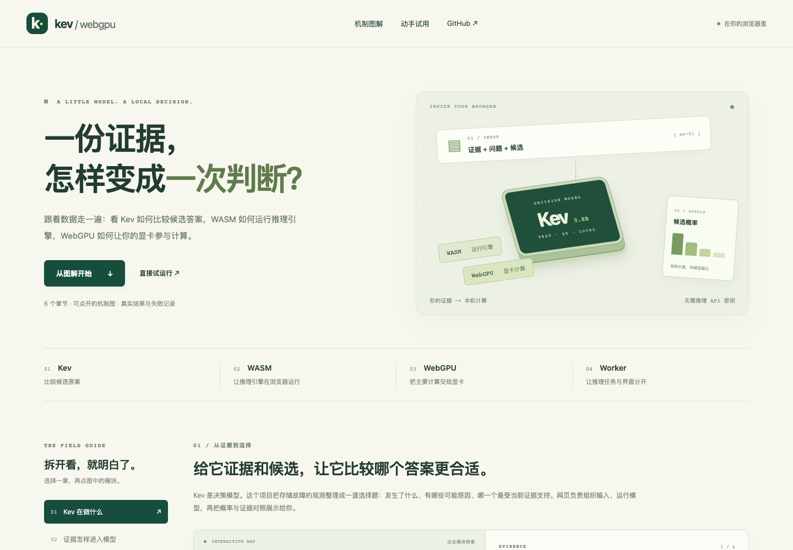
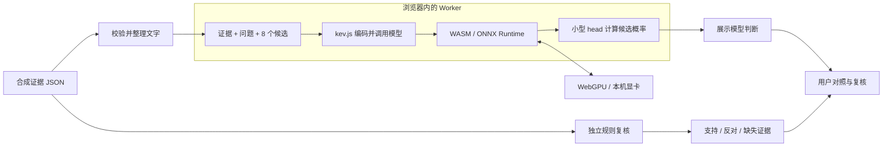
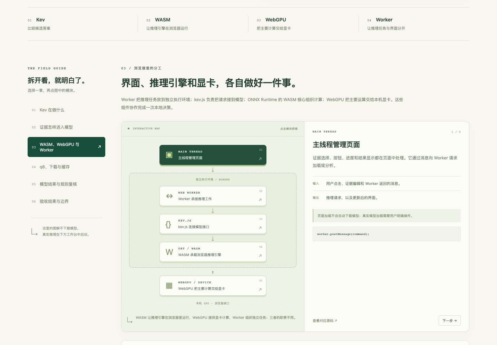

# kev-webgpu

**用可点击的图示，解释一份证据怎样变成模型的一次判断。**

[打开六章图解](https://minatoaquamk2.github.io/kev-webgpu/) · [打开真实推理工作台](https://minatoaquamk2.github.io/kev-webgpu/demo/) · [GitHub 源码](https://github.com/minatoaquaMK2/kev-webgpu) · [验证记录](docs/verification.md)

这个项目把一个常见问题拆开演示：存储访问失败后，把观测、问题和候选原因交给 **Kev 0.8B**，让它比较各候选的概率，再用独立规则核对证据。介绍页参考 [intelligent-ui](https://github.com/minatoaquaMK2/intelligent-ui) 的交互讲解思路，点击图中模块即可看到输入、输出、作用和对应源码。

这是学习与研究演示。真实 q8 推理链路已在 Apple M3 / Chrome 上运行；**当前合成 RCA 判断仅 8/34 正确，语义验收未通过**。错误结果原样保留，不能作为生产诊断工具。



## 先理解四个角色

| 名称 | 在这里做什么 | 一个容易理解的说法 |
| --- | --- | --- |
| Kev | 根据证据比较指定候选，返回选项概率 | 负责“判断哪一个更合适”的模型 |
| WASM / WebAssembly | 在浏览器中运行编译后的 ONNX Runtime 核心，组织模型运算及部分 CPU 工作 | 让推理引擎能在网页里运行 |
| WebGPU | 让引擎把支持的矩阵、注意力等主要计算交给本机显卡 | 浏览器访问 GPU 的接口 |
| Web Worker | 把加载与推理任务放到独立线程，和页面交互分开 | 承接任务的后台工作线程 |

**使用 WebGPU 仍然需要 WASM。** Worker 不是显卡，WASM 也不等于“全模型都在 CPU 上计算”。tokenizer、小型 JS pointer head、形状和控制逻辑仍可在 CPU 上运行。



这条路径比较候选答案，不逐字生成诊断文章。页面说明与规则对照由应用另行组织，不能看作模型的思维链。



## 六章图解可以看什么

| 章节 | 可以亲手操作的内容 |
| --- | --- |
| 1. Kev 在做什么 | 拆开实际请求，查看证据、问题和八个候选 |
| 2. 证据怎样进入模型 | 切换 A/B/C 证据阶段，查看真正的 `state` 文字 |
| 3. WASM、WebGPU 与 Worker | 逐层查看分工，并只读检查当前浏览器能力 |
| 4. q8、下载与缓存 | 对比首次加载、缓存命中与加载后断网的流程 |
| 5. 模型结果与规则复核 | 回放三个历史实测案例，点击证据 ID 核对事实 |
| 6. 验收结果与边界 | 区分数值一致、领域判断和性能三类结果 |

图解不会自动下载模型。历史回放读取的是 [34 条已记录结果](public/guide-validation.json)，不是当前设备的新推理；切换下载流程图也不会改变真实网络或缓存。

想实际运行时，打开页面下方的工作台，或直接访问 [`/demo/`](https://minatoaquamk2.github.io/kev-webgpu/demo/)。选择合成案例，主动点击 **Load** 加载模型，再点击 **Analyze** 分析。编辑或导入新的证据后，旧结果会失效，需要重新运行。

## 在本机启动

使用 **Node.js 24** 和 npm；真实推理需要支持 WebGPU、`shader-f16` 及相应缓冲区限制的浏览器/GPU。图解和案例浏览不要求先加载模型。

```sh
git clone https://github.com/minatoaquaMK2/kev-webgpu.git
cd kev-webgpu
npm ci
npm run dev
```

默认地址：

- 图解：`http://127.0.0.1:5173/`
- 真实推理工作台：`http://127.0.0.1:5173/demo/`
- 开发用模型验证器：`http://127.0.0.1:5173/tests/model-validation/index.html`

如果端口已占用，以 Vite 输出的地址为准。开发服务器默认只监听本机。

固定模型首次完整下载 **826,680,926 bytes**，约 826.7 MB / 788.4 MiB，包括 33 个文件。先检查设备能力，再从锁定的公共 Hugging Face 地址下载并逐文件校验 SHA-256。权重不进入 Git 仓库或 Pages 产物。下载大小不等于运行内存或显存。

已经成功加载、且保持打开的标签页，可继续断网分析新证据。首次离线打开、关闭后重开、离线刷新均不作保证。

## 检查与构建

| 命令 | 作用 |
| --- | --- |
| `npm test` | 规则、证据处理、运行时与界面的单元测试 |
| `npm run build` | TypeScript 检查并构建图解与工作台到 `dist/` |
| `npm run check` | 依次执行单元测试和构建 |
| `npm run preview` | 本机预览已经构建的静态页面 |
| `npm run test:browser` | Playwright 浏览器 UI 检查，需要已安装对应 Chromium |
| `npm run test:browser:local` | 使用本机安装的 Chrome 运行 UI 检查 |
| `npm run test:gpu:local` | 显式执行真实模型与浏览器验收；需要另一个终端先启动开发服务器 |

若使用 Playwright 自带 Chromium，可先运行 `npx playwright install chromium`。普通构建和 CI 不下载模型权重，也不声称完成 GPU 验收。

真实 GPU 验收使用独立 `.local-browser-profile/`，会写入本地 `results/`；未命中模型缓存时会下载约 827 MB。它使用已安装 Chrome 的正常沙箱，不添加不安全 GPU 参数。默认连接 `http://127.0.0.1:5173`，需要改端口时设置 `KEV_LOCAL_URL`。

按 GitHub Pages 仓库子路径预览：

```sh
PAGES_BASE=/kev-webgpu/ npm run build
npm run preview
```

随后打开 `http://127.0.0.1:4173/kev-webgpu/` 和 `http://127.0.0.1:4173/kev-webgpu/demo/`。Pages 工作流在 `main` 推送或手动触发时构建并发布；部署结果可在 [Actions](https://github.com/minatoaquaMK2/kev-webgpu/actions) 查看。具体设置和上线验收见 [部署说明](docs/deployment.md)。

## 已有实测怎样理解

这些是 2026-10-11 的历史设备记录，不代表访问者当前设备的速度或新一轮模型结果。

| 项目 | 结果 |
| --- | --- |
| 合成 RCA 开发集 | 8/34 正确；0/9 正确弃权，语义验收失败 |
| 上游数值诊断 | 43 组编码一致，49/49 问题通过既定数值容差；没有最高概率选项翻转 |
| 历史设备性能 | Apple M3 / Chrome 154，3 次预热后 30 次计时；P50 401.5 ms，P95 960.5 ms |
| 真实 GPU 证据 | 独立原生 profile 中，840 条大矩阵/注意力算子事件由 WebGPU 执行；仍有 CPU 工作 |
| 仍未完成 | 完整正式 parity、峰值 VRAM、长期稳定性；线上部署与真实 GPU 运行已验证，见验证记录 |

49 项上游检查说明编码和数值调用链路接近参考结果，**不等于答对 49 个 RCA 问题**。概率仅是在当前候选间的相对分配，尚未校准为真实诊断正确率。详细来源、温度处理、失败案例、误差与验收边界见 [公开验证记录](docs/verification.md)。

## 想继续看源码

| 位置 | 内容 |
| --- | --- |
| `src/guide/` | 六章图解、交互实验与历史回放 |
| `src/app/`、`demo/index.html` | 真实 RCA 工作台与请求构造 |
| `src/evidence/` | 证据格式校验与可追溯文字输入 |
| `src/domain/` | 候选定义、独立证据规则 |
| `src/workers/`、`src/runtime/` | Worker、GPU 能力检查、下载校验和模型生命周期 |
| `src/runtime/model-lock.json` | 固定 checkpoint、版本、文件大小和摘要 |
| `public/cases/` | 八个合成事故案例 |
| `tests/model-validation/` | 24 个变体、预设评分标签、性能和 parity 验证器 |
| `tests/fixtures/upstream/` | 固定上游 fixture 与生成器来源 |

只使用 **Kev-0.8B text q8、kev.js 1.0.0、ONNX Runtime 1.30.0**。不支持时会明确失败，不自动替换模型、精度或改用云端推理。

更多说明：[模型来源](docs/model-provenance.md) · [RCA 验证方法](docs/rca-validation.md) · [浏览器验收历史](docs/browser-validation.md) · [限制](docs/limitations.md) · [原始规格](spec.md)。

## 数据边界

内置案例都是合成数据。应用不把导入证据发送给推理服务；站点资源和公共模型下载仍会产生普通网络元数据。使用组织数据前仍应遵守组织的数据处理要求。

页面不会连接或修改真实基础设施，也不会执行探测、命令、配置变更或支持请求。下一步建议只是供人审核的文字。本项目独立开发，并非 Dell 官方或认证的诊断产品。
